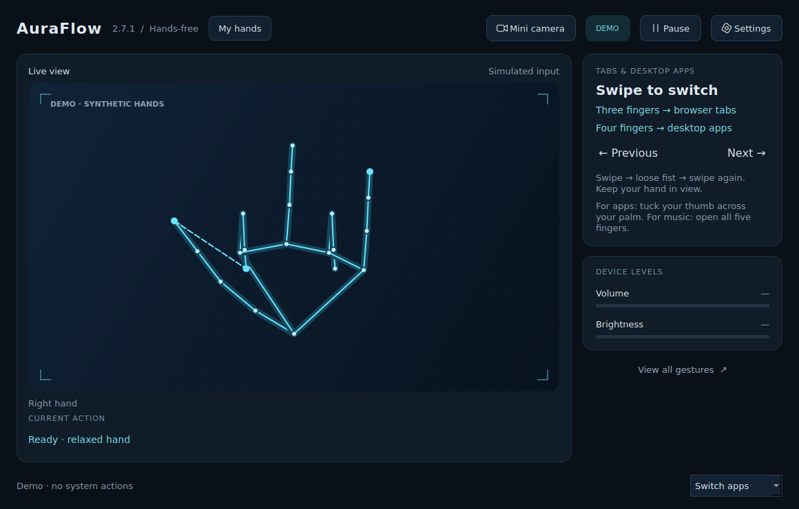

<div align="center">

# AuraFlow
### Hands-free Windows control powered by computer vision

**Version 2.7.1** · Python · OpenCV · MediaPipe · Qt

Control your desktop with hand gestures—no mouse or keyboard required for supported actions.

</div>



> **Status:** Prototype. Automated gesture, Qt lifecycle, and rendered-UI checks were performed on Linux; live Windows camera tracking and hardware effects still need testing on the target laptop.

## Overview

AuraFlow is a Windows desktop application that interprets webcam hand landmarks as commands for everyday computer interaction. Move the pointer, click, adjust volume or brightness, control media, switch browser tabs and desktop applications, zoom, capture screenshots, and pause controls—all from a single dashboard without choosing modes.

The camera opens automatically. Controls become available after camera settling and hand verification. Camera video stays on your computer. AuraFlow does **not** show an in-app camera consent dialog; Windows camera privacy settings may still block access.

## Features

- **Desktop interaction:** Cursor movement, clicking, scrolling, app switching, browser-tab navigation, and closing the focused window.
- **System and media controls:** Volume, brightness, mute, media playback, and track navigation.
- **Two-hand shortcuts:** Zoom, reset zoom, screenshots, and show/hide desktop.
- **Hand enrollment:** Local experimental hand-geometry verification with separate left/right profiles.
- **Continuous use:** Reset completed gestures with a brief fist without taking your hands out of view.
- **Mini camera:** Resizable always-on-top live preview while controls remain active.
- **Safety controls:** Pause/resume gesture, keyboard pause shortcut, and mouse-corner pause.
- **Demo mode:** Try a simulation without a webcam or system actions.

## Getting started

### Requirements

- Windows desktop or laptop with a webcam.
- **64-bit Python 3.12** recommended. The pinned MediaPipe dependency supports Python 3.11/3.12 in this project; if you already use Python 3.13, install Python 3.12 alongside it.
- The complete project folder, including its scripts, `requirements.txt`, and model assets.

### Installation

1. Download the project ZIP (or clone the repository) and extract it into a **new folder**. Keep its contents together.
2. Install 64-bit Python 3.12 if needed.
3. Double-click **`Start_AuraFlow.bat`**. On first launch, the script installs dependencies.
4. Confirm the application title says **AuraFlow 2.7.1**.
5. Allow desktop camera access in Windows privacy settings if the webcam is blocked.
6. Enroll your hands using the instructions below before attempting gesture controls.

**Optional:** `Try_Demo.bat` launches a simulation with no webcam or system commands. `Build_EXE.bat` can build a Windows executable locally.

## Application preview

The dashboard shows the live camera, current action, volume/brightness indicators, and a browser-tab hint. Select **View all gestures** for the in-app guide; controls pause while the guide is open and return to their previous pause state when it closes.

The **Mini camera** button switches to a small always-on-top window showing hand landmarks, detected hand, current action, and live/paused state. Move or resize it as needed; its size and position are remembered. **Dashboard** or closing the mini window returns to the full interface. Closing the main dashboard exits AuraFlow. Both views share the same camera connection.

## Gesture reference

Keep your palm facing the camera and your entire hand visible. **Right** and **left** refer to anatomical hands (check the live label; see Settings below).

| Gesture | Result |
|---|---|
| Right index finger only; move the whole hand | Move cursor using index knuckle |
| Right thumb/index pinch after opening | Left click; cursor freezes during pinch |
| Right thumb/index pinch, pinky extended, middle/ring folded | Adjust volume |
| Left thumb/index pinch, pinky extended, middle/ring folded | Adjust brightness |
| Fold pinky | Stop adjusting volume/brightness |
| Hold right fist | Mute/unmute |
| Hold left fist | Play/pause media |
| One open five-finger palm; horizontal swipe | Previous/next media track |
| One V sign; vertical movement | Scroll |
| Four fingers extended, thumb tucked; horizontal swipe | Switch desktop apps (Alt+Tab / Alt+Shift+Tab) |
| Index + middle + ring extended; horizontal swipe | Switch tabs in focused app (Ctrl+Tab / Ctrl+Shift+Tab) |
| Pinch with both hands, then spread / bring together | Zoom in / out |
| Both fists held 0.9 seconds | Reset zoom |
| Two V signs held 1.2 seconds | Windows screenshot shortcut |
| Two open palms held 1.2 seconds | Show/hide desktop |
| **Left thumbs-up alone** held 0.9 seconds | Pause/resume all actions |
| **Middle finger only**, thumb and other fingers tucked; one steady hand held 1.2 seconds | Close focused window (Alt+F4) |

### Swipes, shortcuts, and repeat actions

- **Tabs:** Focus the browser or another app supporting tab shortcuts, hold index + middle + ring, and swipe horizontally in the direction shown by the preview. Right goes to the next tab; left goes to the previous. You may hold the pose before swiping—there is no initial 0.8-second deadline. This switches **tabs**, not separate application windows. A shortcut-sent message confirms the shortcut was issued, not that every application responded.
- **Apps:** Extend four fingers with thumb tucked and swipe right for Alt+Tab or left for Alt+Shift+Tab. Each gesture sends/releases one shortcut; Windows determines recent-app order. A partly folded thumb is neutral. Two four-finger hands do not activate Show Desktop.
- **Repeat without leaving frame:** After a swipe or confirmed hold action, make a loose fist for about **0.25 seconds**, wait for **Ready**, then open steadily for about **0.15 seconds** before the next action. The reset fist is consumed, so it will not accidentally mute, play/pause, or reset zoom. To mute deliberately afterward, open your hand and form a fresh fist. Continuous pointer movement, level adjustment, zoom, and scrolling do not require this reset. Clicking still uses opening and reclosing the pinch.
- **Two-hand gestures** suppress single-hand commands. Keep your other hand out of view for single-hand actions. The left thumbs-up alone controls pause/resume; misclassification is still possible, so watch feedback.
- **Shortcut support:** Zoom uses Ctrl+plus/minus and Ctrl+0; support depends on the focused application. Screenshots use Win+PrintScreen (normally saved under Pictures/Screenshots). Show desktop uses Win+D. AuraFlow does not delete files or send messages.

### Close-window gesture: use with care

Show only the middle finger on **one hand**, tuck the others and thumb, and hold steady for **1.2 seconds**. The preview displays progress. Moving or changing pose cancels the countdown. AuraFlow sends **Alt+F4 once** to the focused window: it does not force-quit or dismiss unsaved-work prompts. If the desktop is focused, Windows may show its shutdown dialog. Practice using the **Close app demo** first. Briefly make a fist and reopen to reset.

## Enroll and verify your hands

AuraFlow's local hand-geometry filter starts **enabled**.

1. Open **My hands → Enroll / replace right hand**.
2. Show **only your right hand**, palm facing the camera, all fingers spread. Hold still for roughly **four seconds (60 accepted frames)**.
3. Repeat for the **left hand** to use brightness, pause/resume, and two-hand gestures.
4. If the labels are swapped, correct them in **Settings** before enrolling.
5. Show each enrolled open palm for at least **0.6 seconds** to unlock gestures.

Enrollment pauses controls while the camera preview remains live. Canceling keeps existing profiles. You can replace either profile or forget both from **My hands**. Profiles persist between launches in `hand_profile.json` in AuraFlow's local Qt application-data folder; they contain **normalized 3D joint-length ratios**, not photos or video. Existing 2.7 profiles remain compatible.

Once verified, palm geometry and position continuity maintain tracking through pinches, fists, and other poses; curled fingers are not compared against the open-palm finger profile. **All visible hands must be verified**: unmatched, ambiguous, or missing data blocks the entire frame and clears pending controls. Tracking gaps, position jumps, or incompatible palms require fresh open-palm verification. This also applies to pause/resume and Alt+F4; mouse Settings remain available.

### Important verification limitations

This is an **experimental geometry filter, not secure biometric authentication**. Similar hand proportions or a closely substituted hand may pass, and occlusion can interrupt tracking. No measured biometric accuracy or guarantee of owner-only operation is claimed. Settings offers **Strict**, **Balanced**, and **Tolerant** matching, plus an explicit filter-disable switch. Start with **Balanced**; re-enroll in good lighting if rejected. Tolerant matching increases the chance of accepting another person's hand. Demo mode bypasses verification, saves no profiles, and sends no system commands.

## Settings, pause, and recovery

- **Hand labels:** Inference uses the original camera frame; preview mirroring is separate. Raise your actual right hand and check its label. If your camera driver mirrors the image, use **Settings → Swap anatomical left/right labels**.
- **Other settings:** Camera index, display index, pinch range, and smoothing. Controls pause while Settings is open; saving reconnects the camera automatically.
- **Pause/resume:** Hold the **left thumbs-up alone**; `Ctrl+Alt+P` pauses globally. `Esc` pauses while AuraFlow has focus. Moving the physical mouse to the **top-left corner** also pauses controls; move it away before resuming.
- **Tracking interruptions:** A tracking stall pauses controls. When tracking returns, use the left thumbs-up alone to resume. **Reconnect camera** is available after another app or an unplug event interrupts access.
- **Click priority:** A closed thumb/index pinch takes priority over fist or thumbs-up recognition. A curled index during pinch should not turn a click into pause. Thumbs-up requires the thumb clearly separated from the index and pointed upward; right-hand or unlabelled thumbs-up does not pause/resume.

## How it works

```text
Webcam frame
    ↓
Hand landmarks and anatomical hand labels
    ↓
Optional local hand-geometry verification
    ↓
Gesture and motion interpretation
    ↓
Safety gates, hold timers, and reset logic
    ↓
Windows keyboard, mouse, media, and display commands
```

**Main project components** (based on the repository file names):

| Path | Role |
|---|---|
| `main.py` / `bootstrap.py` | Application entry/startup files |
| `auraflow/gestures.py` | Gesture-related logic |
| `auraflow/handsfree.py` | Hands-free interaction logic |
| `auraflow/identity.py` | Hand identity/geometry logic |
| `auraflow/system.py` | System interaction logic |
| `auraflow/widgets.py` | UI widgets |
| `auraflow/workers.py` | Background worker logic |
| `models/hand_landmarker.task` | Hand landmark model asset |
| `requirements.txt` | Python dependencies |
| `tests/` | Automated test files |

## Testing and current limitations

Automated gesture checks, Qt startup/lifecycle checks, and rendered UI checks were performed on **Linux**. The following still need live verification on the target **Windows laptop**: camera hand labels, real-time gesture reliability, and actual hardware/system effects. The hand-geometry filter is experimental and should not be used as a security boundary. Some keyboard shortcuts work only in applications that support them.

## Roadmap

Potential future improvements (not claims about existing functionality):

- Run and document repeatable real-world Windows gesture tests.
- Measure false positives and hand-verification reliability across users and lighting conditions.
- Add a visual setup/troubleshooting guide and demonstration video.
- Improve onboarding and calibration based on testing feedback.

## Version notes

- **2.7.1:** Latest documented release; hand verification continues through curled-finger gestures after open-palm verification.
- **2.5:** Mini camera window with live landmarks and status.
- **2.4:** Gesture reset without removing hands from view.
- **2.3:** Pinch-click priority and stricter thumbs-up recognition.

---

**AuraFlow 2.7.1** · Built for hands-free desktop interaction. Feedback and contributions are welcome once the repository is published.
